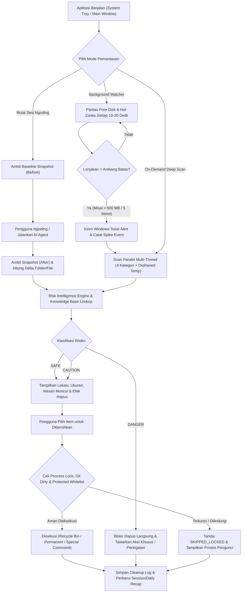
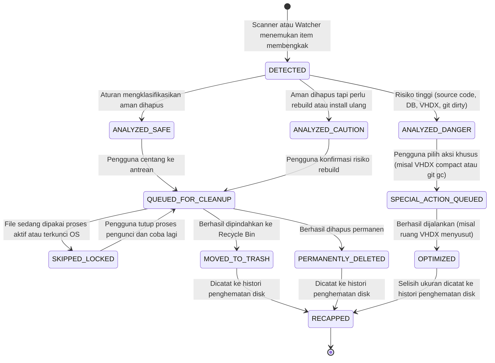
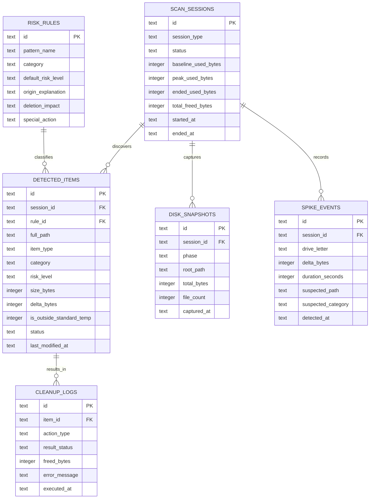

# 📋 PRD: Storage Checker Live — AI & Dev Disk Bloat Monitor (`.exe`)

| Atribut | Detail |
| :--- | :--- |
| **Nama Proyek / Fitur** | **Storage Checker Live** — Lightweight Windows Disk Bloat Monitor, Risk Analyzer & Session Recap (`.exe`) |
| **Versi Dokumen** | 1.0 |
| **Tanggal** | 2026-11-13 |
| **Status** | Ready for Execution |
| **Target Tech Stack** | Rust · Tauri v2 · React 19 · TypeScript · Tailwind CSS v4 · SQLite (`rusqlite`) · Lucide Icons |

---

## 1. Ringkasan Eksekutif & Tujuan (Executive Summary)

**Storage Checker Live** adalah aplikasi desktop Windows super ringan (`.exe` ~5–10 MB, RAM idle `< 30 MB`) yang dirancang khusus untuk memantau, mengalkulasi, dan menganalisis lonjakan penggunaan disk secara mendadak yang sering terjadi saat *coding* menggunakan AI Agent maupun *toolchain* pengembangan modern. Aplikasi ini mendeteksi file/folder yang membengkak secara diam-diam—mulai dari *cache* & *log* AI Agent/IDE, hasil *clone repo* terlantar, *dependency/build artifacts*, file `.tmp` yang tercecer di luar folder Temp standar (*orphaned temp*), hingga pembengkakan virtual disk Docker/WSL2/Android AVD.

Setiap temuan dilengkapi informasi lokasi presisi, kalkulasi ukuran nyata (*actual size on disk*), **penilaian tingkat risiko (`Safe` / `Caution` / `Danger`)**, **penjelasan kontekstual (*kenapa file ini ada & apa dampaknya jika dihapus*)**, eksekusi pembersihan aman ke Recycle Bin atau aksi khusus, serta **Session & Daily Recap** untuk melacak berapa banyak ruang penyimpanan yang membengkak dan berhasil diselamatkan.

> [!IMPORTANT]
> **Prinsip Utama Proyek:** Aplikasi pemantau penyimpanan tidak boleh ikut menjadi *bloat* itu sendiri—wajib berjalan ringan di *System Tray*, memiliki mekanisme proteksi anti-salah-hapus (*process lock check*, *git dirty check*, dan *protected system path whitelist*), serta selalu memberikan penjelasan bahasa manusia sebelum pengguna mengeksekusi penghapusan.

---

## 2. Rekap Keputusan Kunci (`Grill-Me` Decision Log)

Tabel ini merangkum seluruh keputusan arsitektur, fitur, dan batasan yang telah dikunci bersama pengguna:

| No | Area / Topik | Keputusan yang Dikunci | Alasan / Implikasi Teknis |
| :- | :--- | :--- | :--- |
| 1 | **Tech Stack & Packaging** | **Rust + Tauri v2 + React 19 / TypeScript / Tailwind CSS v4** | Menghasilkan `.exe` ringan (~5–10 MB) dengan WebView2 native Windows, pemakaian RAM latar belakang `< 30 MB`, serta traversal multithreaded super cepat (`jwalk`/`rayon`). |
| 2 | **Mekanisme Pemantauan** | **Hybrid Monitoring**: Real-time Background Watcher (System Tray + Spike Alert) + Session Baseline & Diff Analyzer + On-Demand Deep Scanner | Pengguna mendapat peringatan otomatis saat disk melonjak drastis tanpa harus membiarkan jendela utama terbuka, sekaligus bisa membandingkan kondisi disk *sebelum vs sesudah* sesi ngoding. |
| 3 | **Cakupan Deteksi Bloat** | **Semua Kategori Utama**: (1) AI Agent & IDE, (2) Dependency, Build & Repo Cache, (3) Orphaned Temp & Hidden Bloat, (4) Virtualisasi & Container (`VHDX`, `AVD`, VM) | Menangkap seluruh pola pembengkakan disk developer modern, termasuk file `.tmp`/`.bak`/`.dmp` yang tercecer di luar folder Temp standar. |
| 4 | **Penilaian Risiko & Edukasi** | **3-Tier Risk Matrix (`Safe` / `Caution` / `Danger`)** + Penjelasan *"Kenapa File Ini Muncul & Efek Jika Dihapus"* | Mencegah pengguna asal menghapus file krusial (seperti `ext4.vhdx` atau `.git` dengan *uncommitted changes*), sembari mempermudah pembersihan item yang benar-benar aman. |
| 5 | **Aksi Pembersihan** | Pindah ke **Recycle Bin (Default)**, **Permanent Delete** (konfirmasi eksplisit), dan **Special Action** (`git gc`, `VHDX compact`, `npm/pnpm/pip cache clean`) | Memberi opsi *rollback* via Recycle Bin dan mencegah kerusakan virtual disk Docker/WSL2 akibat penghapusan mentah. |
| 6 | **Recap & Pelaporan** | **Session / Daily / Weekly Recap** + Top 5 Biang Kerok + Export ke Markdown (`.md`), JSON, dan CSV | Memberi visibilitas historis atas seberapa banyak penyimpanan yang membengkak tiap sesi coding dan total GB yang berhasil dibebaskan. |
| 7 | **Hak Akses Eksekusi (Privilege)** | **Always Run as Administrator** (`requireAdministrator` manifest) | Agar dapat memindai `C:\Windows\Temp`, crash dumps, mengecek *process lock* lintas proses, dan mengeksekusi `VHDX Compact` tanpa terhalang `Access Denied` atau prompt UAC berulang. |

---

## 3. Aktor Pengguna & Matriks Hak Akses (User Modes & Permission Matrix)

Karena aplikasi ini berjalan lokal sebagai utility desktop Windows tanpa sistem multi-user cloud, "aktor" merepresentasikan **Mode Eksekusi & Hak Akses Administrator Penuh**:

> [!IMPORTANT]
> **Always Run as Administrator:** Binary `.exe` wajib dikonfigurasi dengan Windows Application Manifest (`requestedExecutionLevel level="requireAdministrator"`) sehingga aplikasi **selalu berjalan sebagai Administrator** sejak pertama kali diluncurkan (baik UI utama maupun Background Tray Agent). Karena berjalan dengan hak akses penuh, lapis proteksi *Hardcoded Protected System Paths Whitelist* wajib diterapkan secara mutlak di Rust Core untuk mencegah penghapusan file inti OS.

### 3.1 Profil Mode Eksekusi
* **Background Tray Agent (Elevated Administrator):** Berjalan di System Tray dengan hak Administrator untuk membaca metrik ruang disk, memantau *hot zones* user maupun folder sistem (`C:\Windows\Temp`, `%LOCALAPPDATA%`, workspace coding), serta memunculkan Windows Toast Notification saat terjadi lonjakan (*spike*).
* **Interactive Desktop App (Elevated Administrator):** Menggunakan UI utama dengan akses penuh untuk menjalankan Deep Scan menyeluruh (termasuk folder sistem & crash dump Windows), memulai/mengakhiri *Coding Session Diff*, memeriksa *process lock* lintas proses, membersihkan item ke Recycle Bin/Permanent, hingga mengeksekusi *VHDX Compact* secara langsung tanpa prompt UAC berulang.

### 3.2 Matriks Kemampuan & Hak Akses
| Fitur / Aksi | Tray Agent (Elevated) | Desktop App (Elevated) | Catatan Aturan |
| :--- | :---: | :---: | :--- |
| Baca Statistik Disk & Spike Detection | ✅ | ✅ | Menggunakan Win32 / `sysinfo` penuh di latar belakang |
| Deep Scan Folder User, Workspace & `C:\Windows\Temp` | ✅ (Hot Zones) | ✅ (Full) | Tidak terhalang izin folder standar; folder `TrustedInstaller` dilewati aman |
| Inspeksi Process Lock Lintas Proses | ❌ | ✅ | Akses penuh Restart Manager / handle proses untuk deteksi pengunci file |
| Hapus Item ke Recycle Bin / Permanent | ❌ | ✅ | Wajib lolos *Process Lock Check* & *Hardcoded Protected System Paths Whitelist* |
| Jalankan `VHDX Compact` / `wsl --shutdown` | ❌ | ✅ | Dieksekusi langsung dengan hak Admin (tetap wajib konfirmasi dialog pengguna) |
| Lihat & Export Session / Daily Recap | ❌ | ✅ | Data dibaca dari database SQLite lokal di `%LOCALAPPDATA%` |

---

## 4. Alur Pengguna & Sistem (User & System Flow)

### 4.1 Alur Utama Pemantauan, Deteksi, Penilaian Risiko & Recap (Mermaid Flowchart)

### 4.2 Siklus Status Item Temuan (State Diagram)

---

## 5. Spesifikasi Fitur & Kriteria Penerimaan (Functional Requirements)

Prioritas:
* **`P0 (Must-Have)`**: Wajib selesai di iterasi pertama (MVP).
* **`P1 (Should-Have)`**: Penting namun dikerjakan setelah alur `P0` stabil.
* **`P2 (Nice-to-Have)`**: Fitur tambahan / penyempurnaan.

### 5.1 Modul Core Scanner & Orphaned Temp Detector
| ID | Fitur | Prioritas | Deskripsi Perilaku | Acceptance Criteria (Kondisi Sukses) |
| :- | :--- | :---: | :--- | :--- |
| `FR-01` | **Multi-Threaded Deep Directory Scanner** | `P0` | Memindai drive/folder target (`C:\Users\<user>`, direktori workspace kustom, dan lokasi cache sistem) secara paralel menggunakan Rust `jwalk`/`rayon` serta menghitung *logical size* & *size on disk*. | 1. Scan 100.000 file selesai dalam `< 5 detik` di SSD. 2. UI tetap responsif (`60fps`) dengan stream progress real-time. 3. Dapat dibatalkan (*Cancel Scan*) kapan saja tanpa memory leak. |
| `FR-02` | **Detektor 4 Kategori Bloat Developer & AI** | `P0` | Mengelompokkan temuan secara otomatis ke 4 kategori: (1) AI Agent & IDE, (2) Dependency/Build/Repo, (3) Orphaned Temp & System Bloat, (4) Virtualisasi/Container (`VHDX`, `AVD`, VM). | 1. Mengenali folder `.gemini`, `.cursor`, `.vscode`, `.ollama`, `node_modules`, `target`, `venv`, `.pnpm-store`, `.next`, `ext4.vhdx`, dan `.android/avd`. 2. Menampilkan subtotal ukuran (GB/MB) per kategori di dashboard. |
| `FR-03` | **Orphaned `.tmp` & Scatter Hunter** | `P0` | Memburu file `.tmp`, `.temp`, `.bak`, `.old`, `.dmp`, `.log` berukuran besar, atau file yatim piatu tanpa ekstensi valid yang **berada di luar folder Temp standar** (`AppData\Local\Temp` & `C:\Windows\Temp`), seperti di dalam folder project, Desktop, atau root User. | 1. Memisahkan secara jelas temuan *"Inside Standard Temp"* vs *"Orphaned Outside Temp"*. 2. Menampilkan parent folder & estimasi aplikasi pembuatnya jika terdeteksi dari pola nama file. |
| `FR-04` | **Stale Cloned Repo & Bloated `.git` Detector** | `P1` | Mendeteksi folder repositori Git hasil clone yang sudah lama tidak dimodifikasi (misal `> 30 hari` atau memiliki `.git/objects/pack` `> 200 MB` plus `node_modules`/`target` menganggur). | 1. Menampilkan tanggal *last commit / last modified*, ukuran total folder, dan ukuran `.git` vs dependencies. 2. Memberi opsi hapus dependencies-nya saja atau arsipkan/hapus seluruh repo jika bersih. |

### 5.2 Modul Real-time Background Watcher & Session Spike Diff
| ID | Fitur | Prioritas | Deskripsi Perilaku | Acceptance Criteria (Kondisi Sukses) |
| :- | :--- | :---: | :--- | :--- |
| `FR-05` | **System Tray Background Watcher & Spike Alert** | `P0` | Berjalan ringan di System Tray Windows, memantau perubahan free space drive & direktori panas (`%LOCALAPPDATA%`, `%USERPROFILE%\.gemini`, workspace aktif) pada interval terkonfigurasi. | 1. Memakan RAM `< 30 MB` dan CPU `< 1%` saat idle. 2. Mengirim Windows Toast Notification dalam `< 15 detik` ketika ruang disk terpakai melonjak melebihi ambang batas (default `500 MB / 5 menit`, dapat diatur). |
| `FR-06` | **Session Baseline & Diff Analyzer ("Start Coding Session")** | `P0` | Pengguna menekan tombol **"Start Session"** sebelum ngoding atau menjalankan AI Agent. Aplikasi mengambil *baseline snapshot* ringkas (ukuran folder level 1–3 di direktori terpantau), lalu saat **"Stop / Compare"** menampilkan delta pembengkakan secara presisi. | 1. Menampilkan daftar folder/file yang bertambah ukurannya (`+1.84 GB`, `+420 MB`) diurutkan dari delta terbesar. 2. Menyorot file/folder baru yang belum ada saat baseline diambil. |
| `FR-07` | **Live Spike Timeline Feed** | `P1` | Menyimpan titik sampel ruang disk berkala ke SQLite dan menampilkan grafik garis lonjakan (*spike*) per jam/hari sehingga pengguna tahu jam berapa disk mendadak penuh. | 1. Klik pada puncak lonjakan (*peak*) di grafik langsung menyaring daftar `DETECTED_ITEMS` / `SPIKE_EVENTS` pada rentang waktu tersebut. |

### 5.3 Modul Risk Intelligence Engine & Knowledge Base ("Why & Impact")
| ID | Fitur | Prioritas | Deskripsi Perilaku | Acceptance Criteria (Kondisi Sukses) |
| :- | :--- | :---: | :--- | :--- |
| `FR-08` | **3-Tier Risk Classifier Engine** | `P0` | Menetapkan status `SAFE` (Hijau), `CAUTION` (Kuning), atau `DANGER` (Merah) berdasarkan aturan pola path, ekstensi, usia file, status Git, dan lock proses. | 1. 100% item hasil scan memiliki badge Risk Level & skor kepercayaan. 2. Tidak ada folder source code utama atau database aktif yang pernah diberi label `SAFE`. |
| `FR-09` | **Contextual Explainer ("Kenapa Muncul & Efek Dihapus")** | `P0` | Menyediakan panel penjelasan berbahasa Indonesia/Inggris yang mudah dipahami untuk setiap kategori/item: asal-usul file (misal AI agent scratch, npm cache, cargo debug build) dan konsekuensi konkret bila dihapus. | 1. Setiap item memiliki field `origin_explanation` dan `deletion_impact` di UI Inspector. 2. Untuk `CAUTION`, tercantum estimasi waktu/perintah rebuild (misal *"Jalankan `npm install` untuk memulihkan"*). |
| `FR-10` | **Custom User Whitelist & Rule Overrides** | `P1` | Mengizinkan pengguna menandai path tertentu sebagai *Protected / Ignore Forever* atau mengubah ambang batas deteksi usia *stale repo*. | 1. Path yang masuk whitelist tidak akan pernah muncul di daftar rekomendasi hapus otomatis dan dilewati saat eksekusi batch. |

### 5.4 Modul Safe Cleanup Executor & Special Optimizer
| ID | Fitur | Prioritas | Deskripsi Perilaku | Acceptance Criteria (Kondisi Sukses) |
| :- | :--- | :---: | :--- | :--- |
| `FR-11` | **Tiered Cleanup Execution (Recycle Bin vs Permanent)** | `P0` | Mendukung dua mode hapus: **Move to Recycle Bin** (default untuk semua item `SAFE`/`CAUTION` di bawah batas ukuran) dan **Permanent Delete** (wajib konfirmasi dialog bertingkat). | 1. File yang dipindahkan ke Recycle Bin dapat dipulihkan dari Windows Recycle Bin. 2. Progress bar menampilkan path aktif, jumlah item tersisa, dan total byte yang sudah dibebaskan. |
| `FR-12` | **Pre-Delete Safety Guards (Process Lock & Git Dirty Check)** | `P0` | Sebelum menghapus, backend memeriksa apakah proses aktif (`code.exe`, `node.exe`, `cargo.exe`, `python.exe`, `docker.exe`, dll.) sedang mengunci target atau apakah folder repo memiliki perubahan Git yang belum di-commit. | 1. Jika terkunci atau ada *uncommitted changes*, item otomatis dilewati/diberi peringatan merah dan tidak memicu crash. 2. Menampilkan nama proses yang mengunci jika terdeteksi. |
| `FR-13` | **Special Optimizer Actions (VHDX Compact, Git GC, Cache Clean)** | `P1` | Untuk item `DANGER` yang membengkak namun tidak boleh dihapus mentah (seperti `ext4.vhdx` Docker/WSL2 atau `.git` repo raksasa), aplikasi menyediakan tombol aksi aman seperti *Compact VHDX*, *Docker Prune*, atau `git gc --prune=now`. | 1. Tombol `Compact VHDX` menampilkan konfirmasi penghentian WSL (`wsl --shutdown`) lalu langsung mengeksekusi optimasi dengan hak Administrator yang sudah aktif. 2. Mengukur dan mencatat ukuran sebelum vs sesudah optimasi. |

### 5.5 Modul Session/Daily Recap & Analytics Dashboard
| ID | Fitur | Prioritas | Deskripsi Perilaku | Acceptance Criteria (Kondisi Sukses) |
| :- | :--- | :---: | :--- | :--- |
| `FR-14` | **Session & Daily/Weekly Storage Recap** | `P0` | Merangkum total ruang yang sempat membengkak selama sesi ngoding/harian/mingguan, **Top 5 Penyebab Pembengkakan**, total GB yang berhasil dibersihkan, serta sisa potensi ruang yang masih bisa dihemat. | 1. Menampilkan kartu ringkasan instan setelah sesi coding berakhir atau setelah cleanup selesai. 2. Data bertahan lintas restart aplikasi karena tersimpan di SQLite lokal. |
| `FR-15` | **Export Recap Report (`.md`, `.json`, `.csv`)** | `P1` | Mengekspor laporan lengkap (daftar temuan, lokasi, ukuran, risk level, dan ringkasan cleanup) ke file lokal. | 1. File `.md` yang diekspor rapi dengan tabel ringkasan dan siap dibaca/disimpan sebagai arsip audit. |
| `FR-16` | **Quick Tray Mini-Recap & One-Click Safe Sweep** | `P2` | Klik kanan/kiri pada icon System Tray menampilkan popover mini berisi status free space saat ini, lonjakan terakhir, dan tombol cepat untuk membuka scanner. | 1. Popover terbuka dalam `< 200 ms` tanpa memuat ulang jendela utama secara penuh. |

---

## 6. Aturan Bisnis, Validasi & *Edge Cases*

> [!WARNING]
> Seluruh *edge case* di bawah ini wajib memiliki penanganan eksplisit di lapisan Rust Core Engine (validasi path, OS API guard, dan error handling non-panik) maupun React Frontend (umpan balik visual yang jelas).

| ID | Skenario / Edge Case | Perilaku yang Diharapkan (Expected Behavior) | Lapisan Penanganan |
| :- | :--- | :--- | :--- |
| `EC-01` | **File / folder sedang dikunci oleh proses aktif** (misal `node.exe`, `cargo.exe`, `antigravity`, atau `vscode` sedang menulis log) | Tangkap error `ERROR_SHARING_VIOLATION` / `AccessDenied` tanpa menghentikan batch cleanup; identifikasi proses pengunci via Windows Restart Manager API / `sysinfo`; tandai status item sebagai `SKIPPED_LOCKED` dan sarankan tutup proses terkait. | Rust Core (`cleanup`, `process_guard`) & UI |
| `EC-02` | **Folder repo target memiliki *uncommitted Git changes* atau file `.env`** | Saat memindai atau mengantrekan repo untuk dihapus, cek status `.git` (`git status --porcelain` atau inspeksi index/working tree) dan keberadaan file `.env*`. Jika kotor atau ada `.env`, naikkan Risk Level menjadi `DANGER` dan blokir penghapusan batch satu klik. | Rust Core (`risk_engine`) & UI Modal |
| `EC-03` | **File `.tmp` di luar folder Temp merupakan file aktif database atau dokumen** (misal SQLite `-wal`/`-shm` atau lockfile editor) | Jangan langsung tandai `SAFE` jika file `.tmp` berumur `< 24 jam` atau berada tepat di sebelah file `.sqlite`/`.db`/`.docx` yang sedang aktif; turunkan ke `CAUTION` dengan label *"Kemungkinan file transaksi/lock aktif"*. | Rust Core (`orphan_detector`, `risk_engine`) |
| `EC-04` | **Penghapusan folder raksasa berisi >100.000 file kecil** (`node_modules`, Rust `target/`) | Jalankan penghapusan secara asinkron di *background worker thread pool* Rust dengan throttling event progress ke frontend (maks 10 update/detik) agar WebView2 UI tidak freeze atau kehabisan channel buffer. | Rust Core (`async runtime`, Tauri Events) |
| `EC-05` | **Pembengkakan `ext4.vhdx` / `docker_data.vhdx` puluhan GB** | Larang keras penghapusan file `.vhdx` secara langsung (Hardcoded `DANGER` rule). UI wajib menyembunyikan tombol "Delete" untuk `.vhdx` dan menggantinya dengan aksi **"Inspect / Safe Compact VHDX"** (menjalankan `wsl --shutdown` + `Optimize-VHD` / `diskpart compact vdisk`). | Rust Core (`risk_engine`, `vhdx_optimizer`) & UI |
| `EC-06` | **Symlink / Junction Loop & Permission Denied pada folder Windows** (`C:\Windows\System32`, `Documents and Settings` junction) | Nonaktifkan follow-symlinks pada `jwalk` traversal untuk mencegah *infinite loop* dan penghitungan ukuran ganda (*double-counting*). Lewati error izin (`PermissionDenied`) secara senyap dengan mencatat counter *"Skipped protected paths"* di summary. | Rust Core (`scanner`) |
| `EC-07` | **Ukuran file/folder melebihi batas kapasitas Windows Recycle Bin** | Cek apakah operasi `trash::delete` gagal karena ukuran melebihi kuota Recycle Bin atau path terlalu panjang (`> 260 chars` tanpa prefix `\\?\`). Tangani path panjang dengan Windows extended-length path `\\?\`, dan tawarkan fallback konfirmasi *Permanent Delete* jika Recycle Bin penuh. | Rust Core (`cleanup`) & UI Dialog |
| `EC-08` | **Lonjakan palsu (*False Positive Spike*)** saat pengguna mengunduh file media/ISO besar di `Downloads` | Kategorikan lonjakan di `Downloads` atau folder non-coding sebagai *"Non-Dev / User Download"* di alert & recap sehingga tidak tercampur dengan analisis AI/Dev bloat, namun tetap dilaporkan jika pengguna ingin memeriksanya. | Rust Core (`watcher`, `categorizer`) |

---

## 7. Arsitektur Data & Skema Database Lokal (SQLite Data Model)

Aplikasi menyimpan seluruh riwayat sesi, baseline snapshot, event lonjakan, aturan risiko, dan histori recap secara lokal menggunakan **SQLite (`%LOCALAPPDATA%\StorageCheckerLive\storage_checker.db`)** agar instan, portabel, dan nol ketergantungan server eksternal.

### 7.1 Entity-Relationship Diagram (Mermaid)

### 7.2 Detail Tabel & Indeks Penting
* **Tabel `scan_sessions`**:
  * **Kolom Kunci & Tipe**: `id` (`TEXT` UUID PK), `session_type` (`TEXT`: `DEEP_SCAN` / `CODING_SESSION` / `BACKGROUND_WATCH`), `status` (`TEXT`: `RUNNING` / `COMPLETED` / `CANCELLED`), `baseline_used_bytes` (`INTEGER`), `peak_used_bytes` (`INTEGER`), `ended_used_bytes` (`INTEGER`), `total_freed_bytes` (`INTEGER`), `started_at` (`TEXT` ISO-8601), `ended_at` (`TEXT` nullable).
  * **Index**: Index pada `(session_type, started_at DESC)` untuk memuat halaman Recap & History secara instan.
* **Tabel `detected_items`**:
  * **Kolom Kunci & Tipe**: `id` (`TEXT` PK), `session_id` (`TEXT` FK -> `scan_sessions.id` `ON DELETE CASCADE`), `rule_id` (`TEXT` FK nullable -> `risk_rules.id`), `full_path` (`TEXT`), `item_type` (`TEXT`: `FILE` / `DIRECTORY`), `category` (`TEXT`: `AI_IDE` / `DEV_DEPS` / `ORPHAN_TEMP` / `VIRTUALIZATION` / `OTHER`), `risk_level` (`TEXT`: `SAFE` / `CAUTION` / `DANGER`), `size_bytes` (`INTEGER`), `delta_bytes` (`INTEGER`), `is_outside_standard_temp` (`INTEGER` boolean 0/1), `status` (`TEXT`), `last_modified_at` (`TEXT`).
  * **Index**: Index komposit `(session_id, category, risk_level)` dan `(session_id, size_bytes DESC)` untuk sorting/filtering tabel UI tanpa lag.
* **Tabel `disk_snapshots`**:
  * **Kolom Kunci & Tipe**: `id` (`TEXT` PK), `session_id` (`TEXT` FK -> `scan_sessions.id` `ON DELETE CASCADE`), `phase` (`TEXT`: `BEFORE` / `AFTER` / `PERIODIC`), `root_path` (`TEXT`), `total_bytes` (`INTEGER`), `file_count` (`INTEGER`), `captured_at` (`TEXT`).
  * **Index**: Index pada `(session_id, phase, root_path)` untuk operasi diff snapshot `BEFORE` vs `AFTER` dalam hitungan milidetik.
* **Tabel `spike_events` & `cleanup_logs`**:
  * **Index**: `(detected_at DESC)` pada `spike_events` dan `(executed_at DESC)` pada `cleanup_logs` guna agregasi Daily/Weekly Recap.

---

## 8. Arsitektur Sistem, Tauri IPC Commands & Integrasi OS

### 8.1 Pola Arsitektur Kode
* **Backend Core (Rust — `src-tauri/src/`)**:
  * `scanner/`: Traversal paralel berbasis `jwalk` + `rayon`, penghitung *size on disk* Win32 (`GetCompressedFileSizeW`), serta filter symlink/junction loop.
  * `watcher/`: Service latar belakang dengan `notify` + polling ringan `sysinfo` untuk mendeteksi lonjakan ruang disk tanpa membebani I/O.
  * `analyzer/`: *Rule Matcher*, *Orphaned Temp Detector* (membandingkan lokasi temuan terhadap whitelist folder Temp standar), *Git Dirty Checker*, dan *Risk Knowledge Base* (memetakan alasan & dampak penghapusan).
  * `cleaner/`: Eksekutor hapus berbasis `trash` crate (Recycle Bin), `tokio::fs` / `std::fs` dengan Win32 `\\?\` long-path support, *Process Lock Inspector*, dan wrapper perintah aman (`wsl --shutdown` + `diskpart`/`Optimize-VHD`, `git gc`).
  * `storage/`: Koneksi & migrasi SQLite (`rusqlite` dengan mode `WAL`), generator laporan `.md`/`.json`/`.csv`.
* **Frontend UI (React 19 + TypeScript — `src/`)**:
  * `stores/`: State management ringan (Zustand) untuk menampung progress scan, filter aktif, antrean cleanup, dan status watcher.
  * `hooks/`: Wrapper `invoke` Tauri & event listener (`listen('scan:progress')`, `listen('watcher:spike_detected')`).
  * `pages/` & `components/`: Modular views dengan virtualized table (`@tanstack/react-virtual`) agar rendering ribuan item tetap `60fps`.

### 8.2 Daftar Tauri IPC Commands & Event Streams
| Tipe | Nama Command / Event | Parameter Input | Output / Payload | Deskripsi Perilaku |
| :--- | :--- | :--- | :--- | :--- |
| `Invoke` | `start_deep_scan` | `{ targetPaths: string[], includeSystemTemp: boolean }` | `{ sessionId: string }` | Memulai scan paralel multi-thread di background dan memancarkan event progress. |
| `Invoke` | `cancel_scan` | `{ sessionId: string }` | `{ cancelled: boolean }` | Mengirim sinyal atomik (`AtomicBool`) untuk menghentikan thread scanner seketika. |
| `Invoke` | `start_coding_session` | `{ watchPaths: string[] }` | `{ sessionId: string, baselineBytes: number }` | Mengambil baseline snapshot (`BEFORE`) direktori target dan mengaktifkan pemantauan sesi aktif. |
| `Invoke` | `compare_coding_session` | `{ sessionId: string }` | `SessionDiffSummary` | Mengambil snapshot (`AFTER`), menghitung delta per folder, dan mengembalikan top items yang membengkak. |
| `Invoke` | `get_item_inspection` | `{ itemId: string }` | `ItemInspectionDetail` | Mengembalikan analisis lengkap: path, ukuran, age, status git, lock proses, `origin_explanation`, & `deletion_impact`. |
| `Invoke` | `execute_cleanup` | `{ itemIds: string[], mode: 'RECYCLE_BIN' \| 'PERMANENT' }` | `CleanupBatchResult` | Menjalankan safety guard, memindahkan/menghapus item, dan mencatat `cleanup_logs`. |
| `Invoke` | `run_special_action` | `{ itemId: string, action: 'COMPACT_VHDX' \| 'GIT_GC' \| 'OPEN_EXPLORER' }` | `SpecialActionResult` | Menjalankan aksi optimasi aman (atau membuka folder di Windows Explorer). |
| `Invoke` | `get_recap_summary` | `{ range: 'SESSION' \| 'TODAY' \| 'WEEK' \| 'ALL', sessionId?: string }` | `RecapAnalytics` | Mengambil ringkasan total pembengkakan, Top 5 Bloat Culprits, total ruang diselamatkan, & timeline grafik. |
| `Invoke` | `export_recap_report` | `{ range: string, format: 'MD' \| 'JSON' \| 'CSV', savePath: string }` | `{ filePath: string }` | Menghasilkan file laporan recap ke lokasi yang dipilih pengguna. |
| `Event` | `scan:progress` | — | `{ scannedFiles: number, scannedBytes: number, currentPath: string }` | Stream update progress scan ke UI (throttled tiap `100ms`). |
| `Event` | `watcher:spike_detected` | — | `SpikeEventPayload` | Dikirim saat background watcher mendeteksi lonjakan disk mendadak. |
| `Event` | `cleanup:progress` | — | `{ completed: number, total: number, freedBytes: number, currentPath: string }` | Stream progress saat menghapus folder dependency besar. |

### 8.3 Integrasi Native Windows OS
* **Always-Elevated Manifest (`requireAdministrator`)**: Menyematkan custom Windows Application Manifest (`app.manifest` via `tauri-build` / `winres`) dengan `requestedExecutionLevel level="requireAdministrator"` agar binary `.exe` selalu berjalan sebagai Administrator.
* **Windows System Tray & Auto-Start**: Menggunakan plugin resmi `tauri-plugin-tray` serta pendaftaran Windows Task Scheduler (`schtasks` dengan `RunLevel Highest`) untuk fitur *Auto-Start* (karena Windows Registry `HKCU\Run` standar tidak mengizinkan auto-launch aplikasi `requireAdministrator` saat login tanpa UAC prompt).
* **Windows Toast Notification**: Menggunakan `tauri-plugin-notification` untuk memberi tahu pengguna saat lonjakan disk terjadi di latar belakang, lengkap dengan aksi klik untuk langsung membuka hasil analisis.
* **Windows Recycle Bin & Long Path Support**: Menggunakan crate `trash` (memanggil `IFileOperation` COM interface Windows) dan prefix `\\?\` untuk path `node_modules` bersarang yang melebihi 260 karakter.
* **Protected System Paths Whitelist (Hardcoded Safety)**: Backend menolak keras segala operasi hapus pada `C:\Windows\System32`, `C:\Windows\WinSxS`, `C:\Program Files`, `C:\Users\<user>\Documents` (kecuali sub-cache/temp eksplisit), serta file konfigurasi aplikasi sendiri.

---

## 9. Spesifikasi UI/UX, Layout & State Komponen

* **Arah Desain & Tema**: *Industrial Precision Utility — High-Craft Dark Mode*. Menggunakan palet warna gelap netral (`#0B0E14` background, `#141923` elevated surface) untuk efisiensi baterai dan kenyamanan mata developer, dipadukan tipografi *sans-serif* bersih (`Inter`) untuk label dan *monospace* (`JetBrains Mono` / `Consolas`) untuk ukuran byte dan path file. Warna semantik dikalibrasi ketat: **Emerald (`#10B981`)** untuk `SAFE`, **Amber (`#F59E0B`)** untuk `CAUTION`, dan **Rose (`#EF4444`)** untuk `DANGER`.
* **Daftar Halaman / Layar Utama**:
  1. **Live Overview & Session Diff Dashboard**: Status kesehatan drive real-time (`Free / Total`), tombol utama **"Start Coding Session"** / **"Quick Deep Scan"**, grafik *Spike Timeline*, serta 4 kartu ringkasan per kategori bloat.
  2. **Deep Explorer & Bloat Inspector (Split-Pane)**: Sisi kiri berisi tabel virtual *sortable/filterable* (filter by Kategori, Risk Level, Ukuran Minimal, Status Orphaned), dan sisi kanan berisi **Inspector Panel** yang menampilkan path lengkap, tombol *Open in Explorer*, serta penjelasan ***"Kenapa Ini Muncul"*** dan ***"Apa Efek Jika Dihapus"***.
  3. **Orphaned `.tmp` & Scatter Hunter**: Tampilan khusus yang memisahkan file `.tmp`/`.bak`/`.dmp`/`.log` yang tercecer di luar folder Temp standar beserta konteks folder induknya.
  4. **Cleanup Queue & Safety Confirmation Modal**: Ringkasan item terpilih, pemisahan visual jumlah item `SAFE` vs `CAUTION`, selector mode **Recycle Bin (Aman)** vs **Permanent Delete**, serta daftar peringatan jika ada item yang sedang dikunci proses aktif.
  5. **Recap & History Center**: Laporan per-sesi, harian, dan mingguan — memuat total GB pembengkakan yang terjadi, Top 5 Biang Kerok, total ruang yang berhasil diselamatkan, riwayat eksekusi cleanup, dan tombol **Export Report (`.md` / `.json` / `.csv`)**.
* **4 State Wajib di Setiap Tampilan Data**:
  * **Loading / Scanning State**: Indikator progres real-time (jumlah file terpindai, kecepatan scan, path aktif saat ini) + *skeleton loader* pada kartu kategori.
  * **Empty / Clean State**: Ilustrasi/pesan informatif (*"Tidak ditemukan bloat atau file orphaned temp di area ini"*) beserta tombol CTA untuk memperluas cakupan scan ke drive lain.
  * **Error / Locked State**: Banner peringatan non-destruktif yang menyebutkan path bermasalah, kode alasan (misal `Locked by node.exe` atau `Protected by Windows TrustedInstaller`), dan tombol aksi alternatif (*Retry* / *Skip*).
  * **Success State**: Notifikasi toast + banner ringkasan instan menampilkan angka akurat ruang yang berhasil diselamatkan (misal `"4.82 GB berhasil dipindahkan ke Recycle Bin"`).

---

## 10. Kebutuhan Non-Fungsional (Security, Performance & Footprint)

* **Footprint Ringan (`.exe` & RAM)**:
  * Ukuran installer/binary release Windows target **`< 12 MB`** (menggunakan WebView2 bawaan Windows 10/11, strip symbols + LTO pada `Cargo.toml` release profile).
  * Konsumsi RAM saat berjalan di System Tray (background watcher) **`< 30 MB`**, dan CPU idle **`< 1%`**.
* **Performa Scan & UI**:
  * Kecepatan traversal directory minimal **`50.000 file/detik`** pada NVMe SSD.
  * Rendering tabel hasil scan hingga `50.000 baris` tanpa lag menggunakan *list virtualization*.
* **Keamanan & Privasi Lokal**:
  * **100% Offline & Local-First**: Tidak ada telemetri, tidak ada pengiriman nama path/file/proyek pengguna ke server eksternal mana pun.
  * **Strict IPC Validation**: Setiap command `execute_cleanup` di Rust wajib memvalidasi ulang target path terhadap *Hardcoded Protected Paths Whitelist* sebelum mengeksekusi operasi filesystem apa pun (defense-in-depth, tidak percaya 100% pada payload dari frontend).

---

## 11. Batasan Ruang Lingkup (Out of Scope / Non-Goals)

Untuk menjaga aplikasi tetap fokus, ringan, dan bebas *scope creep*, fitur-fitur berikut secara tegas **TIDAK** termasuk dalam versi 1.0:
* ❌ **Dukungan macOS / Linux** — Versi 1.0 fokus 100% pada Windows 10/11 (`.exe`, NTFS, Win32 Recycle Bin, WSL2 VHDX).
* ❌ **Penghapusan Otomatis Tanpa Konfirmasi (*Silent Auto-Delete*)** — Aplikasi tidak boleh menghapus file secara diam-diam di latar belakang tanpa persetujuan eksplisit pengguna.
* ❌ **Windows Registry Cleaner / Driver Updater / Antivirus** — Aplikasi hanya berfokus pada penggunaan penyimpanan file & direktori, bukan modifikasi Windows Registry.
* ❌ **Cloud Sync / Web Dashboard / Akun Login** — Seluruh data tetap lokal di SQLite mesin pengguna.

---

## 12. Roadmap Eksekusi AI (Phase-by-Phase Implementation Plan)

Daftar periksa terstruktur di bawah ini siap dieksekusi langsung menggunakan **`/plan`**, **`/goal`**, atau **`/teamwork`**:

### Fase 1: Inisialisasi Proyek Tauri v2 + Rust Core & SQLite Foundation (`P0`)
- [x] Inisialisasi proyek **Tauri v2 + React 19 + TypeScript + Tailwind CSS v4** di workspace `Storage-Checker-Live` dengan konfigurasi build `.exe` ringan (`lto = true`, `opt-level = "z"` / `"s"` pada `Cargo.toml`) serta Windows Manifest `requireAdministrator` agar aplikasi selalu berjalan sebagai Administrator.
- [x] Siapkan modul database SQLite (`rusqlite` + mode WAL) dan jalankan skema migrasi tabel `scan_sessions`, `disk_snapshots`, `detected_items`, `risk_rules`, `spike_events`, dan `cleanup_logs` lengkap dengan indeks.
- [x] Isi *seed knowledge base* awal untuk `risk_rules` mencakup ke-4 kategori bloat (AI/IDE, Dependencies/Build/Repo, Orphaned Temp/System, Virtualization `VHDX`/`AVD`) beserta teks *"Kenapa Muncul"* dan *"Efek Jika Dihapus"*.

### Fase 2: Core Scanner, Orphaned Temp Hunter & Risk Engine (`P0`)
- [x] Implementasikan `scanner` paralel berbasis `jwalk`/`rayon` dengan penghitung *size on disk*, proteksi symlink/junction loop (`EC-06`), dan pembatalan atomik (`cancel_scan`).
- [x] Implementasikan `orphan_detector` untuk memisahkan file `.tmp`/`.temp`/`.bak`/`.dmp`/`.log` di luar folder Temp standar serta cek transaksi database aktif (`EC-03`).
- [x] Implementasikan `risk_engine` (3-Tier `SAFE` / `CAUTION` / `DANGER`), *Git Dirty & `.env` Checker* (`EC-02`), dan *Hardcoded Protected Paths Whitelist*.
- [x] Hubungkan Tauri IPC `start_deep_scan`, `cancel_scan`, dan `get_item_inspection` dengan event stream `scan:progress`.

### Fase 3: Safe Cleanup Executor, Background Watcher & Session Diff (`P0`)
- [x] Implementasikan `cleaner` dengan `trash` crate (Recycle Bin default), extended-length path `\\?\`, konfirmasi *Permanent Delete*, dan *Process Lock Checker* (`EC-01`, `EC-07`).
- [x] Implementasikan `watcher` di System Tray Windows (`tauri-plugin-tray` + `tauri-plugin-notification`) untuk mendeteksi lonjakan ruang disk berkala (`watcher:spike_detected`) dengan jejak RAM `< 30 MB`.
- [x] Implementasikan fitur **Session Baseline & Diff Analyzer** (`start_coding_session` & `compare_coding_session`) serta penyimpanan otomatis ke `disk_snapshots`.

### Fase 4: Frontend UI Dashboard, Inspector & Session Recap (`P0`)
- [x] Bangun layout utama *Industrial Precision Dark UI* dengan navigasi: **Live Overview & Session Diff**, **Deep Explorer & Inspector**, **Orphaned Temp Hunter**, dan **Recap Center**.
- [x] Implementasikan tabel virtual berkecepatan tinggi (`@tanstack/react-virtual`), filter Kategori/Risk/Orphaned, dan **Inspector Side-Panel** untuk menampilkan penjelasan *"Kenapa Muncul & Efek Dihapus"*.
- [x] Bangun **Cleanup Confirmation Modal** (Recycle Bin vs Permanent + ringkasan proteksi) serta seluruh 4 State Wajib (Loading, Empty, Error/Locked, Success).
- [x] Bangun **Recap & History Center** (`get_recap_summary`) lengkap dengan Top 5 Biang Kerok dan total ruang yang berhasil diselamatkan.

### Fase 5: Fitur Sekunder (`P1`/`P2`), Optimasi & Verifikasi Build `.exe`
- [x] Implementasikan `Stale Repo & .git Bloat Detector` (`FR-04`), `Live Spike Timeline Chart` (`FR-07`), `Custom User Whitelist` (`FR-10`), dan `Export Recap (.md / .json / .csv)` (`FR-15`).
- [x] Implementasikan **Special Optimizer Actions** (`FR-13`): `git gc` aman dan *Safe VHDX Compact* (`wsl --shutdown` + dialog konfirmasi untuk Docker/WSL2 `ext4.vhdx`, berjalan langsung dengan hak Administrator sesuai `EC-05`).
- [x] Tulis unit & integration tests di Rust untuk: *Protected Path Guard*, *Orphaned Temp Detection*, *Risk Classification*, dan *Snapshot Diff Calculation*.
- [x] Lakukan `cargo tauri build` untuk menghasilkan binary `.exe` release, verifikasi ukuran binary, uji pemakaian RAM System Tray, serta uji end-to-end seluruh alur UI dan edge cases.
